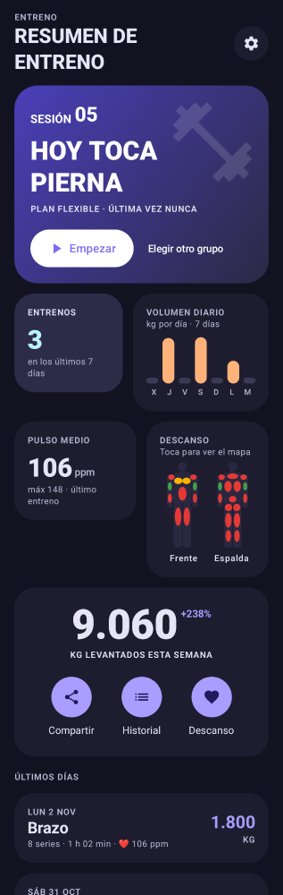
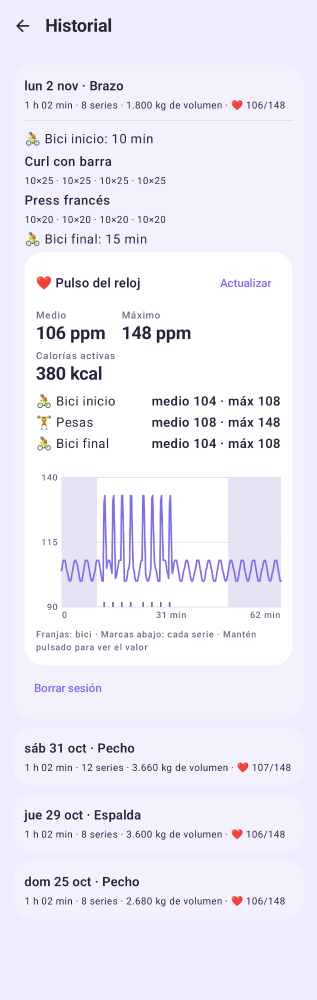

# Entreno

App Android para el gym que te guía en la rutina y te avisa en el **Xiaomi Watch S1 Active**.

El S1 Active no admite apps propias, así que la app corre en el teléfono y el reloj
recibe los avisos como notificaciones (por medio de Mi Fitness): qué serie toca, cuándo
termina el descanso y cuándo acaba la bici.

| Inicio | Serie | Descanso | Resumen | Modo oscuro |
|---|---|---|---|---|
|  |  |  |  |  |

## Qué hace

- **Hoy toca:** sugiere el grupo según tu rotación (Pecho → Espalda → Brazo → Pierna → Hombro).
  No depende del día de la semana: si faltas, no se descuadra. Puedes elegir otro grupo,
  o varios, si el entrenador cambia la rutina.
- **Sesión completa:** 🚴 10 min de bici → pesas → 🚴 15 min de bici. Los tiempos se
  cambian en Ajustes.
- **Pesas:** serie, reps y peso objetivo. Recuerda lo que hiciste la última vez, marca la
  serie con un toque y arranca el descanso solo.
- **Cambios sobre la marcha:** cambiar un ejercicio por otro del mismo músculo (máquina
  ocupada), añadir lo que mande el entrenador, saltar, reordenar o deshacer la última serie.
- **Avisos al reloj:** "▶ Press banca · 2/4 — 10 × 60 kg", "⏱ 10 s de descanso",
  "🚴 Calentamiento terminado".
- **Para el entrenador:** historial, mapa de descanso muscular y un botón para compartir
  los últimos 14 días por WhatsApp.
- **Resumen:** duración, series, volumen, músculos trabajados y récords personales.
- **Pulso del reloj:** pulso medio y máximo de la bici inicial, las pesas y la bici final,
  calorías activas y una gráfica con una marca por cada serie. Llega desde Health Connect
  después del entrenamiento, no en tiempo real.

## Instalación

1. Descarga `app-debug.apk`: lo genera GitHub Actions en cada push
   (pestaña **Actions** → último build → *Artifacts*).
2. Ábrelo en el teléfono y permite instalar apps de esta fuente.
3. Acepta el permiso de notificaciones al abrir la app.

## Configurar el reloj (una sola vez)

1. **Mi Fitness** → tu reloj → **Notificaciones de apps** → activa y marca **Entreno**.
2. Ajustes de Android → Batería: quita la optimización de batería a **Entreno** y a
   **Mi Fitness** (la app tiene un botón para abrir esos ajustes).
3. En la app: **Ajustes → Enviar aviso de prueba al reloj**, con el teléfono bloqueado.
   Si vibra el reloj, ya está.

> Consejo: deja apagado "Mantener la pantalla encendida". Mi Fitness suele reenviar mejor
> los avisos con la pantalla apagada y así evitas toques sin querer en el bolsillo.
> Desde la pantalla de bloqueo puedes marcar "✓ Serie hecha", "+30 s" o "Saltar".

## Pulso y calorías (Health Connect)

El pulso llega así: **reloj → Mi Fitness → Health Connect → Entreno**.

1. **Mi Fitness → Perfil → Health Connect:** activa la frecuencia cardíaca y las calorías.
2. **Entreno → Ajustes → Conectar Health Connect:** permite leer la frecuencia cardíaca.
3. En el gym, inicia también "Fuerza" o "Bicicleta estática" en el reloj para que mida el
   pulso más seguido.
4. Al terminar, abre Mi Fitness para que sincronice. El pulso aparece en el resumen
   (botón "Actualizar") o en el Historial. Se guarda en la sesión una vez encontrado.



## Compilar

Requiere JDK 17+ y el SDK de Android (API 36).

```bash
./gradlew testDebugUnitTest   # tests
./gradlew assembleDebug       # APK en app/build/outputs/apk/debug/
```

Diseño y próximos pasos: [docs/DISENO.md](docs/DISENO.md).
